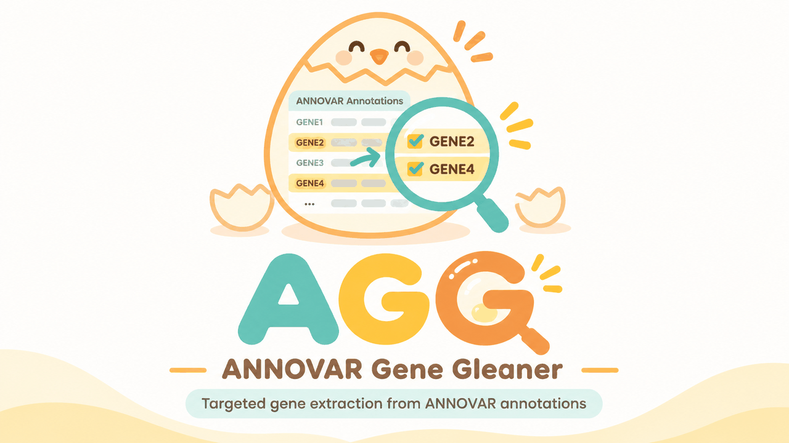

<p align="center">
  
</p>

<h1 align="center">AGG — ANNOVAR Gene Gleaner</h1>

<p align="center"><b>Gene-Centric Variant Extraction from ANNOVAR</b></p>

<p align="center">
  <a href="LICENSE"></a>
  
  <a href="https://github.com/CleanCham-lab/AGG/releases"></a>
</p>

<p align="center"><a href="README.md">English</a> | <b>한국어</b></p>

---

**GATK → ANNOVAR**(`table_annovar.pl`) 분석을 마치면 엑솜·게놈 한 건에서 수만~수백만 행의 annotation 결과가 나옵니다. **AGG**는 그중 유전자 열(기본값 `Gene.refGene`)에 지정한 유전자가 들어 있는 행만 골라 다음 파일로 저장합니다.

```
multianno_<GENE>.csv   또는   multianno_<GENE>.xlsx
```

유전자마다 파일 하나씩 만들거나, 유전자 패널 전체를 파일 하나로 합칠 수 있습니다.

- 명령줄에서 유전자 하나를 지정하거나, Excel 리스트로 유전자 패널을 지정
- 샘플 한 개, 샘플이 든 폴더, glob 패턴 모두 입력 가능
- ANNOVAR의 다중 유전자 셀을 해석하는 정확한 유전자명 매칭
- CSV 또는 Excel 출력과 유전자별 요약표
- 필요한 Python 패키지가 없으면 첫 실행 때 자동 설치

## 설치

Python 3.8 이상이면 내려받아 바로 실행합니다.

```bash
git clone https://github.com/CleanCham-lab/AGG.git
cd AGG
python agg.py -h
```

**빠진 패키지는 자동으로 설치됩니다.** pandas·numpy(그리고 `.xlsx` 입출력 때만 필요한 openpyxl)가 없으면 AGG가 `<지금 실행 중인 python> -m pip install ...`을 한 번 실행한 뒤 이어서 진행합니다. conda 환경이나 venv 안이면 그 환경에, 아니면 사용자 영역(`--user`)에 설치합니다. 이미 설치된 pandas가 너무 오래된 경우(< 1.4)에는 같은 환경의 다른 도구에 영향을 주지 않도록 업그레이드하지 않고 안내만 합니다. pandas 1.5, 2.2, 3.0에서 테스트했습니다.

패키지를 직접 관리하려면:

```bash
python -m pip install -r requirements.txt
python agg.py ... -no-install          # 또는: export AGG_NO_INSTALL=1
```

자동 설치가 실패하면(인터넷 차단, SSL 검사 프록시, OS가 관리하는 Python 등) AGG는 멈추고 직접 실행할 `pip install` 명령과 예상 원인을 출력합니다.

## 빠른 시작

```bash
# 유전자 하나
python agg.py -i example/demo.hg38_multianno.txt -gene RNU4-2 -o results
# -> results/multianno_RNU4-2.csv

# Excel 유전자 리스트(패널), Excel 출력
python agg.py -i example/demo.hg38_multianno.txt -l example/gene_list_example.xlsx -o results -f xlsx
# -> results/multianno_RNU4-2.xlsx, multianno_DMD.xlsx, multianno_BRCA1.xlsx
#    results/multianno_gene_list_example_summary.xlsx
```

추가 예시

```bash
# 명령줄에서 여러 유전자 지정 (공백 또는 쉼표로 구분)
python agg.py -i S01.hg38_multianno.txt -g DMD BRCA1,BRCA2 -o results

# 폴더 안의 모든 multianno 파일 ("Sample" 열이 추가됨)
python agg.py -i annovar_out/ -l panel.xlsx -o results -f xlsx

# 패널 전체를 파일 하나로 -> results/multianno_panel.xlsx ("Matched_Gene" 열이 추가됨)
python agg.py -i annovar_out/ -l panel.xlsx -o results -f xlsx -merge

# exonic / splicing / ncRNA_exonic 변이만
python agg.py -i S01.hg38_multianno.txt -l panel.xlsx -o results -func exonic splicing ncRNA_exonic

# 출력 파일명 앞에 샘플 ID 붙이기 -> results/S01_multianno_DMD.csv
python agg.py -i S01.hg38_multianno.txt -g DMD -o results -prefix S01

# Windows 경로
python agg.py -i "Y:\project\Annotated_VCF" -g RNU4-2 -o "C:\Users\me\Desktop\out"
```

모든 옵션은 한 줄 대시(ANNOVAR 방식, `-gene`)와 두 줄 대시(`--gene`) 형태를 모두 지원합니다.

## 유전자 리스트 형식

Excel(`.xlsx`)에서 **A열 = 번호, B열 = 유전자명**으로 작성합니다. 첫 줄의 헤더는 자동으로 건너뜁니다.

| | A | B |
|---|---|---|
| **1** | No | Gene |
| **2** | 1 | RNU4-2 |
| **3** | 2 | DMD |
| **4** | 3 | BRCA1 |

- A열에만 유전자가 있는 1열짜리 리스트도 됩니다.
- 유전자가 다른 열에 있으면 `-list-col C`(또는 `-list-col 3`)로 지정합니다.
- 같은 구조의 `.csv`, `.tsv`, `.txt`나 한 줄에 유전자 하나씩 적은 텍스트 파일도 됩니다.
- 중복과 빈칸은 무시합니다. 날짜처럼 보이는 값(Excel이 `MARCH1`, `SEPT9` 등을 날짜로 바꾼 경우)은 경고와 함께 건너뜁니다.

예시는 `example/gene_list_example.xlsx`를 참고하세요.

## 옵션

| 옵션 | 설명 |
|---|---|
| `-i`, `-input` | multianno 파일(`.txt`/`.csv`, `.gz` 가능), 폴더, 또는 `"out/*_multianno.txt"` 같은 glob 패턴 |
| `-g`, `-gene` | 유전자명 |
| `-l`, `-list` | 유전자 리스트 파일(`.xlsx`/`.csv`/`.tsv`/`.txt`) |
| `-list-col` | 리스트에서 유전자명이 있는 열 (기본값 `B`) |
| `-o`, `-out` | 출력 폴더 (기본값: 현재 폴더, 없으면 생성) |
| `-f`, `-format` | `csv`(기본값) 또는 `xlsx` |
| `-merge` | 모든 유전자를 파일 하나 `multianno_<NAME>.<fmt>`로 저장 |
| `-name` | 합친 파일·요약 파일의 이름표 (기본값: 유전자 리스트 파일명) |
| `-prefix` | 모든 출력 파일명 앞에 붙일 문자 (예: 샘플 ID) |
| `-genecol` | 검색할 유전자 열 (기본값 `Gene.refGene`; 예: `Gene.ensGene`, `Gene.knownGene`) |
| `-func` | 지정한 `Func.*` 분류만 남김 (예: `exonic splicing ncRNA_exonic`) |
| `-keep-intergenic` | intergenic 행도 포함 (*매칭 규칙* 참고) |
| `-case-sensitive` | 대소문자 구분 매칭 (기본값: 구분 안 함) |
| `-pattern` | `-i`가 폴더일 때 찾을 파일 패턴 (기본값 `*multianno.txt`, `*multianno.txt.gz`, `*multianno.csv`, `*multianno.csv.gz`) |
| `-chunksize` | 한 번에 읽을 행 수 (기본값 200000) |
| `-xlsx-text` | xlsx의 모든 셀을 텍스트로 유지 (기본값: 숫자 열은 숫자로 저장해 Excel에서 정렬·필터가 정확함) |
| `-no-install` | 빠진 패키지를 자동 설치하지 않음 (`AGG_NO_INSTALL=1`과 같음) |
| `-q` | 경고와 오류만 출력 |
| `-v` | 버전 표시 |

## 출력

| 파일 | 생성 조건 | 내용 |
|---|---|---|
| `multianno_<GENE>.csv/.xlsx` | 기본 | 해당 유전자 행의 원본 전체 열 |
| `multianno_<NAME>.csv/.xlsx` | `-merge` | 모든 대상 유전자를 한 표에 + `Matched_Gene` 열 |
| `multianno_<NAME>_summary.csv/.xlsx` | 유전자 2개 이상 | 유전자별 변이 수, 샘플 수, `Func` 분포, Func 필터로 제외된 행 수, 출력 파일명 |

- 입력 파일이 2개 이상이면 파일명에서 따온 `Sample` 열이 맨 앞에 추가됩니다 (예: `S01.hg38_multianno.txt` → `S01`).
- 변이가 없는 유전자는 파일을 만들지 않고, 요약표와 마지막 경고에 표시합니다.
- xlsx 출력은 첫 행 고정과 자동 필터가 걸려 있습니다. Excel 행 제한(1,048,576행)을 넘으면 CSV로 저장합니다.

## 매칭 규칙

1. **정확한 유전자명 일치.** `Gene.refGene`을 `;`, `,`, 이스케이프된 `\x3b` 기준으로 나눈 뒤 각각을 대상 유전자와 비교합니다. `DMD`는 `DMD-AS1`과 일치하지 않고, `BRCA1;NBR2`로 표기된 행은 `BRCA1`과 `NBR2` 모두에 해당합니다.
2. 기본적으로 **대소문자를 구분하지 않습니다** (`dmd` = `DMD`). 구분하려면 `-case-sensitive`를 씁니다.
3. **intergenic 행은 기본적으로 제외합니다.** `Func.refGene = intergenic`일 때 ANNOVAR가 적는 유전자는 양옆의 *flanking* 유전자로, 수십 kb 떨어져 있을 수 있어 그 유전자의 변이로 보기 어렵습니다. `upstream`/`downstream`(1 kb 이내) 행은 유지합니다. 포함하려면 `-keep-intergenic`을 쓰며, 몇 행을 제외했는지 실행 로그에 표시됩니다.
4. **`-func`**는 지정한 분류만 남깁니다 (`exonic;splicing`처럼 여러 분류가 붙은 행은 하나라도 맞으면 유지). `-func`를 주면 intergenic 행은 `intergenic`을 목록에 넣었을 때만 남습니다.

## 참고

- **CSV 결과를 Excel로 바로 열 때 주의하세요.** Excel이 일부 유전자명(`MARCH1`, `SEPT9`, `DEC1`)을 날짜로 바꿉니다. Excel에서 볼 결과라면 `-f xlsx`를 쓰세요.
- 큰 파일은 나눠 읽으므로 메모리 사용량이 적고, 100만 행 multianno도 몇 초 안에 처리합니다.
- `Otherinfo` 헤더 하나 뒤에 여러 값을 쓰는 구버전 ANNOVAR 출력도 처리하며, 추가 열 이름은 `Otherinfo1`, `Otherinfo2`, … 로 붙입니다.
- 유전자명은 annotation DB와 같아야 합니다 (`refGene`은 현행 HGNC 기호 사용). 유전자를 못 찾으면 바뀐 이름이나 별칭인지 확인하거나 `-genecol Gene.ensGene`을 시도해 보세요.

## 예시 데이터

`example/demo.hg38_multianno.txt`는 AGG를 시험해 볼 수 있도록 만든 ANNOVAR 형식의 작은 **가상** 데이터(실제 변이 아님)이고, `example/gene_list_example.xlsx`는 A = 번호 / B = 유전자 구조의 4개 유전자 리스트입니다.

## 개발자

- **채승원 (Seung Won Chae)** — 개발
- **성문우 (Moon-woo Seong)** — 책임연구자 (PI)

서울대학교병원 진단검사의학과 Molecular Diagnostics Laboratory<br>
서울대학교 암연구소

## 인용

AGG를 연구에 활용하셨다면 이 저장소를 인용해 주세요.

> Chae SW, Seong MW. AGG: ANNOVAR Gene Gleaner — Gene-Centric Variant Extraction from ANNOVAR. https://github.com/CleanCham-lab/AGG

## 라이선스

MIT — [LICENSE](LICENSE) 참고.
